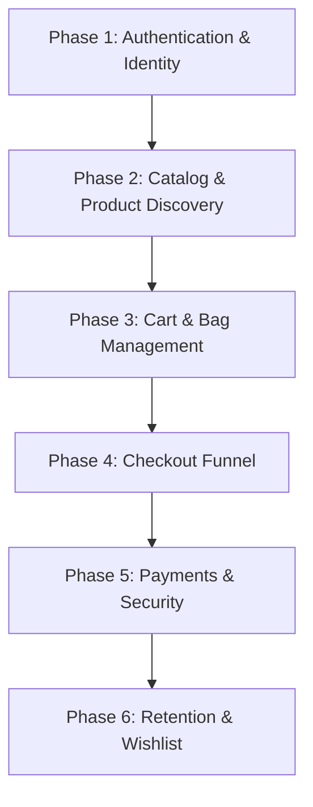

# Test Case Coverage Roadmap

Last updated: 2026-07-01

This document outlines the systematic, phase-by-phase roadmap for test case coverage across the entire Timepieces headless Shopify storefront. Test cases are organized into functional chunks to maintain logical context and tracking.

---

## Roadmap Overview

---

## Phase 1: Authentication & Identity
**Status**: COMPLETE (QA-T1 to QA-T43)

### Functional Areas Covered
- Staging wall password bypass
- OTP verification code sending, validation, and expiry logic
- Phone number input formatting, validation, and country prefix detection
- Multi-region/country selection update behavior
- Security controls: CAPTCHA Turnstile and brute-force attempt limits
- Session management: authorization checks, session revocation, IDOR/BOLA validations

---

## Phase 2: Catalog & Product Discovery
**Status**: IN PROGRESS

### Functional Areas Covered
- Storefront Homepage rendering and key elements (hero banner, timed popups)
- Astonia Timed Drop Card auto-appearance, first/second dismissal, and redirect behaviors
- Sidebar Menu navigation links, submenu drawer expansions, and account links
- Global Search API/UI: keyword matches (canonical, attributes, misspellings, related) and auth-token gating
- Category Page/Collection Page filtering, grid layouts, and sorting
- Product Detail Page (PDP): configuration selections (straps, clasps), image galleries, and pricing updates
- Global Footer links, policy pages, newsletter subscriptions, and social indicators

---

## Phase 3: Cart & Bag Management
**Status**: ACTIVE (Today's Focus)

### Functional Areas Covered
- Slide-out Cart Drawer open/close transitions and overlay clicks
- Add-to-cart operations from PDPs (updates badge, drawer contents, item details)
- Quantity adjustments (increase, decrease, zero/remove item) within the cart drawer
- Price updates: subtotal, taxes, discounts, and item-level totals
- Free Shipping progress bar logic (updates based on subtotal thresholds)
- Cart persistence: local state preservation across tab reloads and sessions

---

## Phase 4: Checkout Funnel & Validation
**Status**: PLANNED

### Functional Areas Covered
- Shopify Checkout transition and user redirection
- Customer Contact Information validation
- Shipping Address fields (domestic vs. international format validation)
- Shipping Method options selection and rates update
- Discount code application and dynamic recalculation
- Error state messaging for missing or incorrect fields

---

## Phase 5: Payment Integration & Security
**Status**: PLANNED

### Functional Areas Covered
- Credit card payment form validation (number, expiry, CVV format validation)
- Checkout Idempotency: multi-click prevention, double-billing mitigations
- Secure token transmission (Stripe / Authorize.Net integration checks)
- Payment declined error handling (insufficient funds, invalid card, expired card)
- Successful payment redirection and Order Confirmation page presentation

---

## Phase 6: Customer Retention & Wishlist
**Status**: PLANNED

### Functional Areas Covered
- Wishlist creation, addition from catalog, and removal
- Guest wishlist persistence vs. authenticated customer account wishlist syncing
- Customer Account portal: order history viewing, order status tracking
- Account settings: updating profile details, saved shipping addresses
