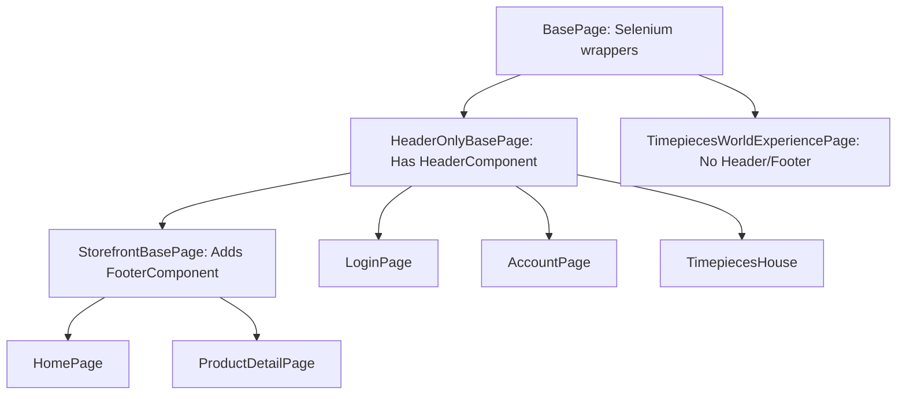

# Timepieces Automation: System Architecture & Coding Standards

This document serves as the technical source of truth for all engineering agents and developers working on the Timepieces automation framework. 

---

## 1. Directory Structure Map

All code must align with the package mapping below:

```
timepieces-automation-framework/
├── docs/                                     # Product and test strategy documentation
│   ├── PRD.md                                # Product requirements
│   ├── system_architecture.md                 # This file (Framework map)
│   └── test-strategy/                        # Specialized test strategies
├── src/
│   ├── main/java/com/timepieces/automation/
│   │   ├── base/
│   │   │   └── DriverFactory.java            # ThreadLocal WebDriver manager
│   │   ├── pages/
│   │   │   ├── BasePage.java                 # Selenium interaction wrappers
│   │   │   ├── HeaderOnlyBasePage.java       # Base for views without footers (Login, Account, House)
│   │   │   ├── StorefrontBasePage.java       # Base for pages with headers & footers (Home, PDP, Cart)
│   │   │   ├── components/                   # COM (Component Object Model) overlay widgets
│   │   │   │   ├── HeaderComponent.java
│   │   │   │   └── FooterComponent.java
│   │   │   └── web/                          # Specific Page Objects (POM)
│   │   └── utils/
│   │       ├── ConfigReader.java             # 3-tier properties resolver
│   │       └── ScreenRecorderUtil.java       # Monte Screen Recorder wrapper
│   └── test/java/com/timepieces/automation/
│       ├── context/
│       │   └── TestContext.java              # PicoContainer DI shared state context
│       ├── hooks/
│       │   └── Hooks.java                    # Cucumber lifecycle hooks (Screenshot/Video attachments)
│       ├── listeners/
│       │   ├── RetryAnalyzer.java            # TestNG Retry counter
│       │   └── RetryAnnotationTransformer.java # Dynamic TestNG Retry injector
│       ├── runners/
│       │   ├── BaseRunner.java               # Abstract TestNG Cucumber base class
│       │   ├── SmokeRunner.java
│       │   ├── SanityRunner.java
│       │   └── RegressionRunner.java
│       └── stepdefinitions/
│           └── LoginSteps.java               # Step definitions (thin routing layer)
```

---

## 2. Page & Component Architecture (Liskov Alignment)

To prevent invalid interactions (e.g., trying to access a footer on the login page), we use a structured page hierarchy:



### Key Architectural Guidelines:
1. **No direct locator sharing**: Pages must expose actions (e.g., `enterUsername()`), not raw locators (`By` objects).
2. **Components**: Encapsulated inside `com.timepieces.automation.pages.components` (COM).
3. **No Assertions in Pages**: Assertions belong *strictly* inside Step Definitions. Page Objects must only return states, boolean checks, or text strings.

---

## 3. State Management (Dependency Injection)

We use **PicoContainer** to share state across step definitions without relying on static variables.

* **`TestContext.java`**: Acts as the dependency carrier. It instantiates the shared data containers (e.g., `ScenarioContext`) and routes references cleanly.
* **Constructor Injection**: All step definition classes must request `TestContext` in their constructor:
  ```java
  public class LoginSteps {
      private final TestContext context;
      private final LoginPage loginPage;

      public LoginSteps(TestContext context) {
          this.context = context;
          this.loginPage = new LoginPage(context.getDriver());
      }
  }
  ```

---

## 4. Test Orchestration & Execution

### TestNG Runners
1. **`BaseRunner.java`**:
   * Controls parallel execution at the Gherkin scenario level (`@DataProvider(parallel = true)`).
   * Defines global `@BeforeSuite` and environment setup parameters.
2. **Suite Runners** (`SmokeRunner`, `SanityRunner`, `RegressionRunner`):
   * Purely structural classes holding `@CucumberOptions` tags and reporting configurations.

### Reruns and Flakiness Mitigation
* **`RetryAnnotationTransformer.java`** dynamically intercepts all dynamic TestNG method compilations.
* It binds **`RetryAnalyzer.java`** to every scenario.
* **`max.retry.count`** is parsed dynamically via environment configurations (`staging.properties` / `production.properties`).

---

## 5. Media Attachments & Allure Reporting

* **Screenshots & Videos**: Captured inside `Hooks.java` on failure.
* **Native Attachments**: Wired using `Scenario.attach(bytes, mimeType, name)`.
* **Report Binding**: The `AllureCucumber7Jvm` plugin declared inside the runners automatically listens to these attachments. **Do not use direct Allure API calls** (`Allure.addAttachment`) to prevent tight coupling.
